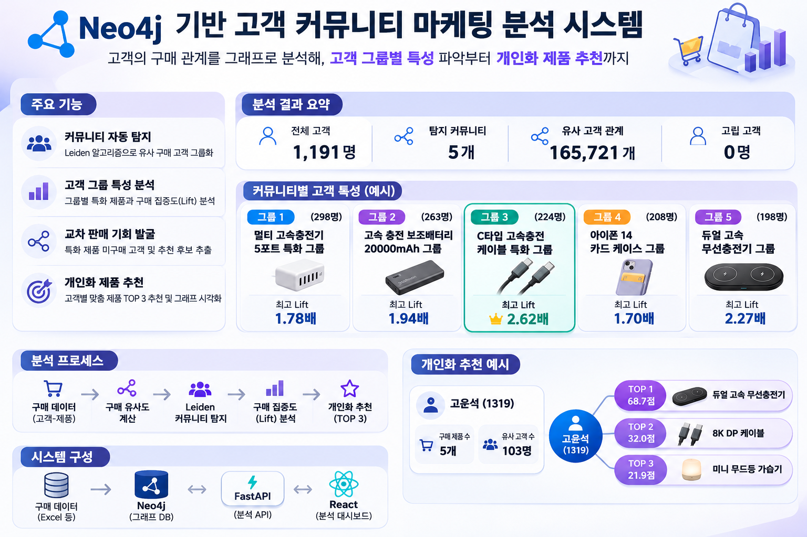

# Neo4j Customer Community Analytics

**Neo4j 기반 고객 커뮤니티 분석 및 개인화 제품 추천 시스템**

고객의 구매 관계를 그래프로 분석하여 유사 고객을 자동으로 그룹화하고, 커뮤니티별 구매 특성과 개인화 추천 제품을 시각화하는 프로젝트입니다.



## 주요 기능

- **고객 관계 분석** — Neo4j 기반 고객·제품 구매 관계 시각화
- **커뮤니티 자동 탐지** — Jaccard 유사도와 Leiden 알고리즘 활용
- **구매 특성 분석** — 커뮤니티별 대표 제품 및 구매 집중도(Lift) 계산
- **교차 판매 분석** — 특화 제품을 구매하지 않은 고객 추출
- **개인화 추천** — 고객별 미구매 제품 TOP 3 추천 및 그래프 시각화

## 분석 결과

| 지표 | 결과 |
|---|---:|
| 전체 고객 | 1,191명 |
| 탐지 커뮤니티 | 5개 |
| 유사 고객 관계 | 165,721개 |
| 고립 고객 | 0명 |

*분석 결과는 최소 Jaccard 유사도 0.20 기준입니다.*

## 기술 스택

| 영역 | 기술 |
|---|---|
| Database | Neo4j |
| Backend | Python, FastAPI |
| Frontend | React, Vite, Ant Design |
| Analysis | Jaccard Similarity, Leiden, Lift |
| Infrastructure | Docker Compose |

## 실행 방법

**1. Neo4j 실행**

```bash
docker compose up -d
```

**2. Backend 실행**

```bash
cd backend
pip install -r requirements.txt
python -m uvicorn app.main:app --reload --port 8000
```

**3. Frontend 실행